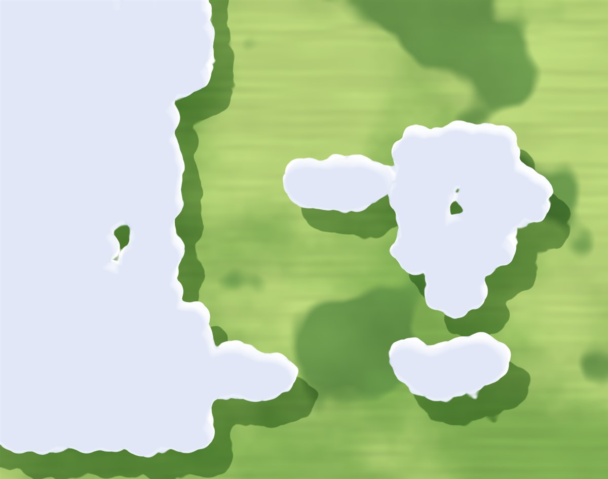
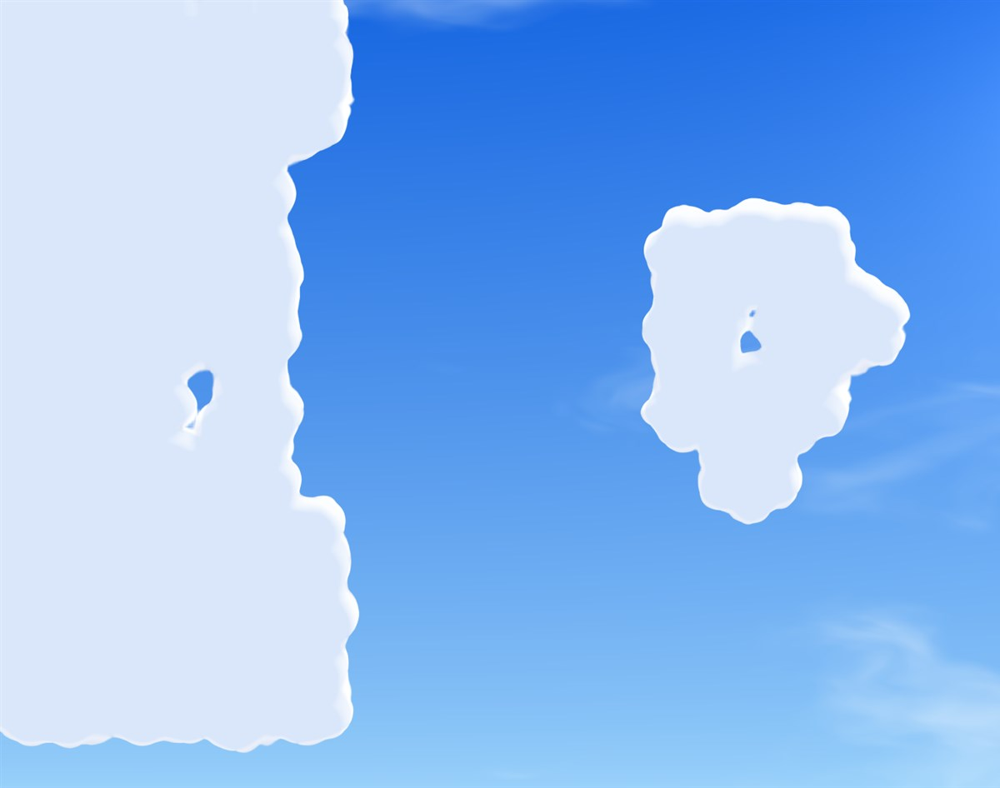
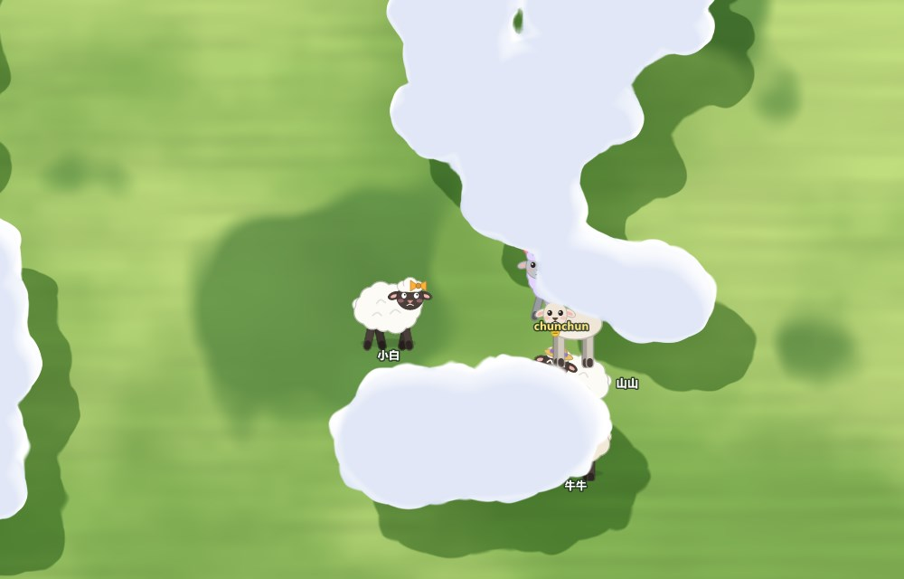
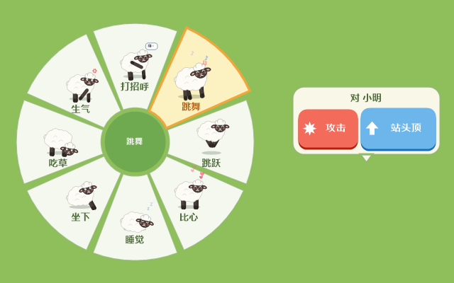
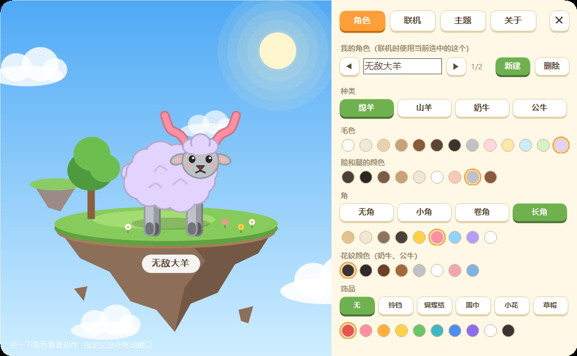
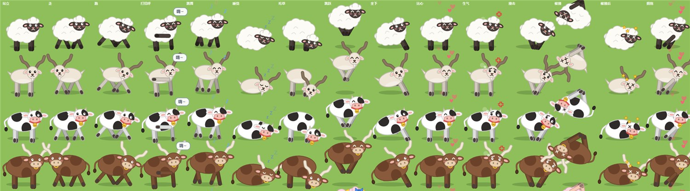
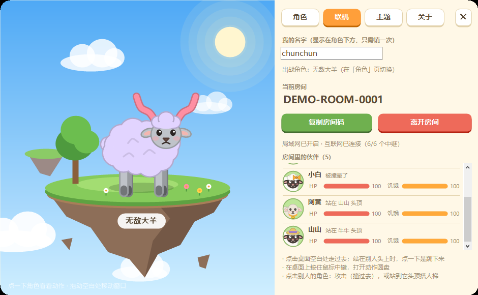
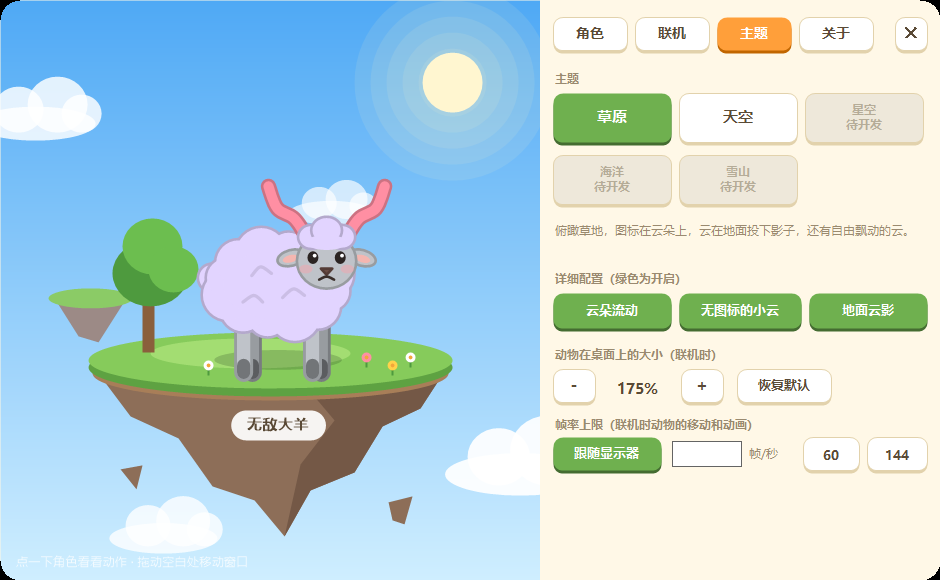

# 云朵动态壁纸

一个实时渲染的 Windows 动态壁纸：它会识别桌面图标的位置，在每个图标下面生成云朵，相邻的云自然地连成一片。
还可以和朋友输入同一个房间码，一起变成草原上的小羊（或者牛）。



> 截图只截了壁纸这一层，所以看不到桌面图标——图中每一片云的下面其实都托着图标。

## 下载

到 [Releases](https://github.com/chunchuna/CloudWallpaper/releases/latest) 下载 `CloudWallpaper.exe`，双击运行即可，不需要安装任何依赖。

- 需要 64 位 Windows 10 或 11，以及正常安装了驱动的显卡（核显也可以）。
- 程序没有数字签名，Windows 可能提示“已保护你的电脑”：点“更多信息 → 仍要运行”。
- 启动后壁纸立即生效并打开菜单窗口；关闭窗口后程序收在右下角任务栏的云朵图标里，双击图标重新打开，右键可以退出。
- 之后有新版本会自动更新，不用重新下载。

## 功能

### 壁纸

- **实时识别桌面图标**：移动、新建、删除图标，云会跟着消散和生长。
- **两个主题**
  - 草原：俯瞰草地，云在地面投下影子，还有自由飘动的小云。
  - 天空：晴朗的蓝天，可以选择“有图标的地方有云”或“没有图标的地方有云”。
- **详细配置**：云朵是否流动、是否生成无图标的小云、是否显示地面云影。
- **不占资源**：桌面被其他窗口（浏览器、游戏等）完全挡住时停止渲染。

| 天空 | 天空（没有图标的地方有云） |
| --- | --- |
|  |  |

### 联机

和朋友输入同一个房间码，就能在各自的桌面上看到彼此。



- **点击桌面空白处**：自己的角色走过去。
- **按住鼠标中键**：打开动作圆盘——打招呼、跳舞、跳跃、比心、睡觉、坐下、吃草、生气。
- **点击别人的角色**：
  - 攻击：跑过去把对方撞飞。
  - 站头顶：站到对方头上，跟着最下面的那只移动。可以一直往上叠，搭人梯；叠到第 4 层会从云里冒出来。站在上面时点一下桌面是跳下来。
- 角色走到云下面会被云遮住。
- 菜单的“联机”页能看到房间里每位伙伴的头像、名字和状态（HP、饥饿目前只是显示，还不会变化）。
- 帧率默认跟随显示器刷新率，也可以在设置里自定义；动物的大小也可以调。



联机不需要服务器，做法参考了开源项目 [lolPing](https://github.com/darrenprx/lolPing)：

- 同一个局域网里用 UDP 广播直接连通；
- 不在一起时通过公共 Nostr 中继转发；
- 所有内容用房间码推导出的密钥加密（AES-256-GCM），中继看不到名字和动作；
- 一个房间最多 16 人。

第一次进房间时 Windows 防火墙可能弹窗，点“允许”局域网才能直连（跨网络不受影响）。

### 捏角色

- 种类：绵羊、山羊、奶牛、公牛。
- 可以调毛色、脸和腿的颜色、角的样式和颜色、牛的花纹颜色、饰品（铃铛、蝴蝶结、围巾、小花、草帽）及其颜色。
- 可以新建多个角色，联机时用当前选中的那个；名字和角色都会记住。





| 联机页 | 主题页 |
| --- | --- |
|  |  |

## 从源码构建

需要 [.NET 8 SDK](https://dotnet.microsoft.com/download/dotnet/8.0)。

```powershell
dotnet run -c Release
```

渲染用的是原生 OpenGL 着色器（没有第三方图形库），角色用 GDI+ 绘制；唯一的依赖是用于给中继事件签名的 `NBitcoin.Secp256k1`。

### 发布新版本

```powershell
$env:GITHUB_TOKEN = "你的令牌"          # 只在当前终端有效，不要写进文件
tools\publish.ps1 -Version 1.1.0 -Notes "更新了什么" -Upload
```

脚本会生成单文件的 `CloudWallpaper.exe` 和 `latest.json`（版本号、文件校验值），并上传为一个新的 Release。
已经安装的程序每隔几小时读取 `update-url.txt` 里的地址，发现版本更高就自动下载、核对 SHA-256、替换并重启。

## 作者

chunchun 和 Claude Fable 5.2
